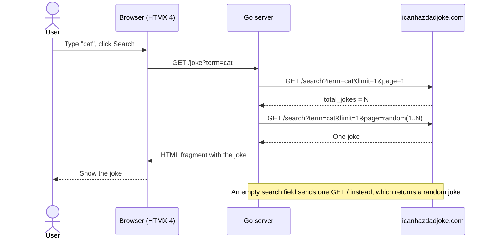

# go-htmx-dad-joke

[](https://github.com/dykstrom/go-htmx-dad-joke/actions/workflows/ci.yml)

A Go/HTMX REST client for icanhazdadjoke.com

## Overview

go-htmx-dad-joke is an application that lets a user search for dad jokes
on icanhazdadjoke.com. The user enters a search word and clicks a search button.
The application retrieves a joke using the icanhazdadjoke.com REST API,
and displays it to the user. The user can also search for a random joke
by leaving the search field empty. If no joke can be found or if an error
occurs, a suitable message is displayed to the user instead.

The backend is built in Go, and the frontend in HTMX 4, using Go's standard
`html/template` package.

## Requirements

Go 1.27.1 or later. The app has no dependencies outside the Go standard
library.

## Run

```sh
go run ./cmd/server
```

Then open <http://localhost:8080>. Set `PORT` to listen on another port, for
example `PORT=9000 go run ./cmd/server`.

## Test

```sh
go test ./...
```

The tests use a fake joke service and need no network. CI also checks the
format and runs `go vet` and the race detector:

```sh
gofmt -l .
go vet ./...
go test -race ./...
```

`gofmt -l .` must print nothing.

One test calls the real icanhazdadjoke.com. It runs only when you ask for it:

```sh
DADJOKE_LIVE=1 go test ./internal/dadjoke -run Live -v
```

## How it works

The server renders the page with `html/template`. When the user clicks
Search, HTMX sends `GET /joke?term=...` and puts the answer in the result
area. A request without HTMX gets the full page, so the form also works
without JavaScript.



When no joke matches, the server answers 404 with a message. When the joke
service fails, it answers 502 with a message and logs the cause.

[docs/system/](docs/system/) describes how the code works today, and
[docs/architecture/](docs/architecture/) lists the rules it must follow.
